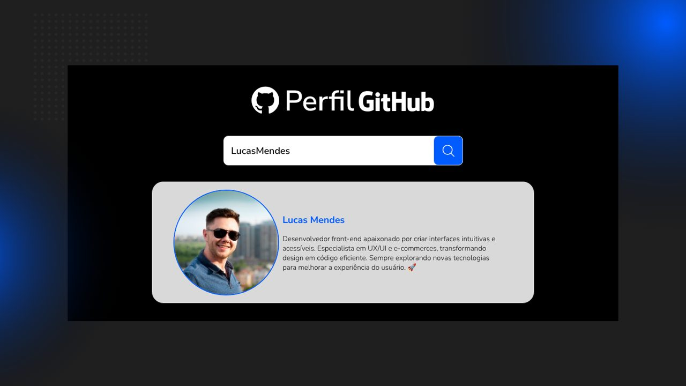

# Avanti Innovation Class 19 — Desafio 02: Busca de Perfil no GitHub

Aplicação em **React** que busca um usuário na API pública do GitHub e mostra foto, nome e bio.



## Tecnologias

- React 18 + Vite
- CSS puro
- Fetch API + [API pública do GitHub](https://docs.github.com/pt/rest/users/users#get-a-user)

## Funcionalidades

- Campo de busca: clique na lupa ou aperte Enter.
- Exibe **foto de perfil**, **nome** e **bio** do usuário (tela 2 do Figma).
- Exibe a mensagem de erro quando o perfil não é encontrado (tela 3 do Figma).
- As três telas seguem o Figma (1440 x 810) e se ajustam à largura da janela.
- No celular (abaixo de 768px) os elementos ficam um embaixo do outro.
- Loading na lupa enquanto a busca acontece.
- Animação de entrada no card do perfil e na mensagem de erro.

## Como rodar

Requer [Node.js](https://nodejs.org/) 18 ou superior.

```bash
npm install
npm run dev
```

Depois, abra o endereço que aparecer no terminal (normalmente http://localhost:5173).

Build de produção:

```bash
npm run build
npm run preview
```

## Estrutura

```
src/
├── App.jsx                    # estado da tela (inicial, sucesso, erro) e a busca
├── App.css                    # estilos com as medidas do Figma
├── index.css                  # reset e estilos globais
├── main.jsx                   # ponto de entrada do React
├── services/
│   └── github.js              # chamada à API e tratamento dos erros
├── components/
│   ├── SearchForm.jsx         # campo + botão
│   ├── ProfileCard.jsx        # foto, nome e bio
│   └── ErrorMessage.jsx       # caixa de erro
└── assets/                    # logo e ícones exportados do Figma
```

## Observação sobre a API

Sem autenticação, a API do GitHub permite **60 requisições por hora por IP**. Se esse limite
acabar, a requisição falha e a aplicação mostra a mesma mensagem de erro.
